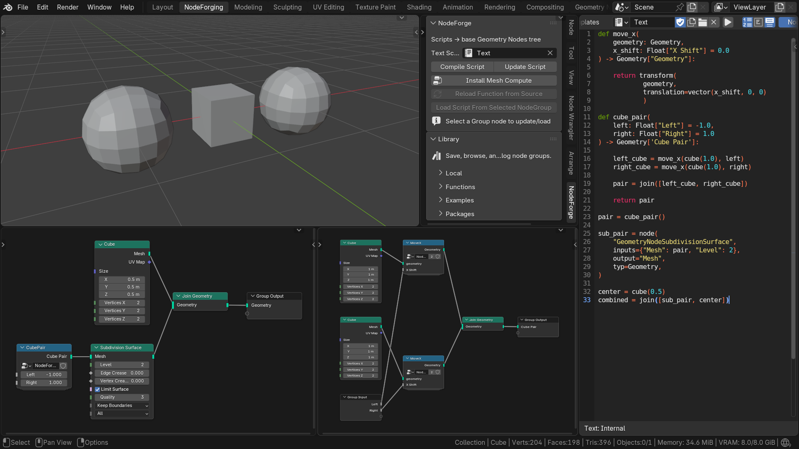

# NodeForge



> **Disclaimer:** NodeForge is a vibe-coded project.

NodeForge is a Blender add-on for describing Geometry Nodes logic in a Python-like language. Executable statements create ordinary nodes directly in the current base Geometry Nodes tree. User-defined functions compile to reusable nested Geometry Nodes groups with typed inputs and outputs.

## Installation

NodeForge requires Blender 5.2 or newer.

1. In Blender, open **Edit → Preferences → Get Extensions**.
2. Under **Repositories**, choose **Add Remote Repository** and enter `https://denikryt.github.io/NodeForge/index.json`.
3. Find **NodeForge**, click **Install**, and enable the add-on.

Installing through this repository lets you receive NodeForge updates in Blender.

To install directly from a ZIP instead, download the latest archive from [GitHub Releases](https://github.com/denikryt/NodeForge/releases/latest), then use **Get Extensions → Install from Disk...** and enable **NodeForge**. Installations from disk are updated by installing a newer ZIP manually.

If you used the earlier ZIP add-on, disable it before enabling the Extension. Your Packages and Local files remain in Blender's user-data directories.

## Quick start

1. Select a mesh object and open the **Geometry Node Editor**.
2. Click **New** to create a Geometry Nodes modifier and node tree for the object.
3. Press `N` and open the **NodeForge** tab in the sidebar.
4. Open a **Text Editor**, click **New**, and enter this `.nf` script:

```python
def make_cube(size: Float["Size"] = 2.0) -> Geometry:
    return cube(size)
```

5. Return to the NodeForge sidebar and select the new text in **Text Script**.
6. Click **Compile Script**. NodeForge places a `make_cube` Group Node in the existing base Geometry Nodes tree; its implementation lives in a nested node group.
7. Connect the Group Node's **Value** output to the existing **Group Output** geometry input.

To compose nodes directly instead, write executable top-level expressions such as `geo = cube(2)`. Calls to declared functions create Group Nodes alongside ordinary nodes. Compilation only inserts new nodes; it does not manage earlier level-0 nodes or automatically connect the base Group Input/Output interface.

An existing generated function group is updated in place when its canonical source definition is rebuilt. To make an independent copy, use Blender **Make Single User**, select the copied Group Node, and click **Detach Selected Copy** before updating the canonical source group.

See the [Get Started guide](https://denikryt.github.io/NodeForgeDocs/latest/GET_STARTED/) for the complete beginner workflow.

## The language at a glance

A module can mix function definitions, imports and ordinary executable statements:

```python
def move_x(geometry: Geometry, x_shift: Float["X Shift"] = 0.0) -> Geometry:
    return transform(geometry, translation=vector(x_shift, 0, 0))

left = move_x(cube(1.0), -2.0)
right = move_x(cube(1.0), 2.0)
combined = join([left, right])
```

Declarations are visible before their textual definition. Parameters use exact Python identifiers as keyword names; `Float["X Shift"]` changes the Blender display label, not the keyword `x_shift`. Every parameter must have an explicit type annotation, even if it has a default. Function-local assignments shadow same-named module definitions and constants; a local read or call before assignment is an error. A parameter without `=` is required in explicit calls, while omitted optional parameters use their declared defaults.

When a module has no executable top-level statements, **Compile Script** automatically places the functions that are not called by other definitions in that same module. All functions, including names beginning with `_`, remain importable.

`node(...)` is the universal low-level form for Blender nodes without a dedicated NodeForge wrapper. It creates an ordinary Blender node, which can be combined with typed function calls and other expressions.

The language is intended to make procedural logic easier to express and maintain as the graph grows. Mathematical relationships can be written directly as expressions, while Geometry Nodes operations remain visible through functions that fit naturally into Python-like code. 

NodeForge scripts can call reusable functions and can be extended through installable third-party packages. This allows project-specific operations and larger procedural components to become part of the language used by other scripts.

## Additional libraries

The Extension includes **NodeForge Math** for math operations and **NodeForge L-System** for procedural L-system generation. Both libraries are installed automatically when you enable NodeForge.

Install or update other libraries from **NodeForge → Packages → Install ZIP**.

Installed package APIs are imported through the package namespace:

```python
from packages import math

def sine(x: Float) -> Float:
    return math.sin(x)
```

Reusable `.nf` files from the Local library, including folders added from disk with **Add Folder...**, can be imported and called from other scripts:

```python
from local import erosion
# erosion.nf exposes declarations, for example:
# result = erosion.apply(geometry)
```

See [Unified `.nf` source reference](docs/UNIFIED_NF.md) for current source syntax, Local imports, function ownership and direct-composition semantics.

## Coverage

The syntax follows Python as closely as the Geometry Nodes model allows. The built-in function library covers only part of Geometry Nodes. When a dedicated NodeForge function is not available, `node(...)` can create the Blender node directly.

See the [Geometry Nodes coverage](https://denikryt.github.io/NodeForgeDocs/latest/GEOMETRY_NODES_COVERAGE/) page for the current feature matrix and the [Core DSL Built-ins](https://denikryt.github.io/NodeForgeDocs/latest/BUILTINS/) reference for the complete `node(...)` syntax.

### How the compiler works

Internally, NodeForge parses the source, resolves its types and operations, builds a semantic intermediate representation, and lowers that representation into Blender nodes. The compiler owns the translation from source-level logic to the final `GeometryNodeTree`, keeping the language-facing part of the system separate from Blender graph construction.

```text
NodeForge source
    ↓
Python AST
    ↓
semantic analysis and NFType checking
    ↓
typed Semantic IR
    ↓
Blender lowering and materialization
    ↓
existing base GeometryNodeTree + nested function GeometryNodeTrees
```

### Learn more in the documentation:
https://denikryt.github.io/NodeForgeDocs/

### Support the developer:
https://www.patreon.com/c/nachitima
